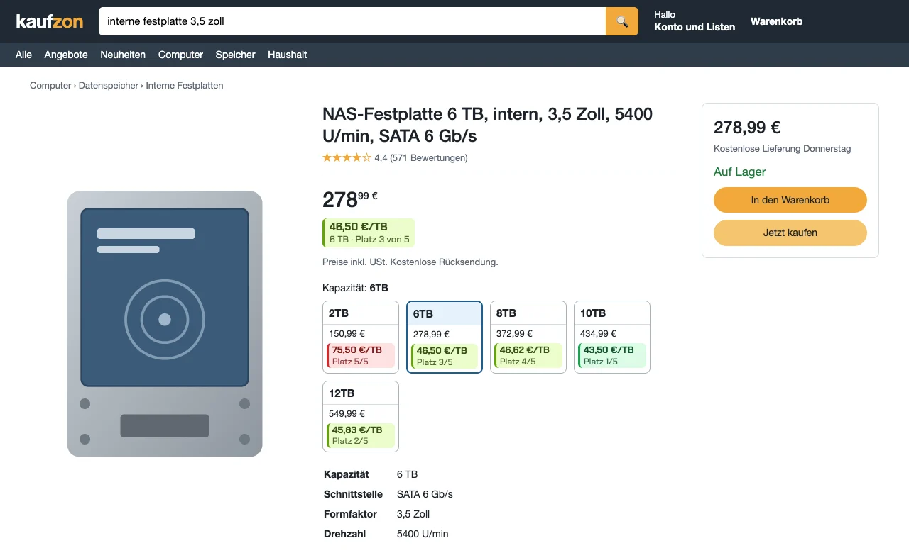
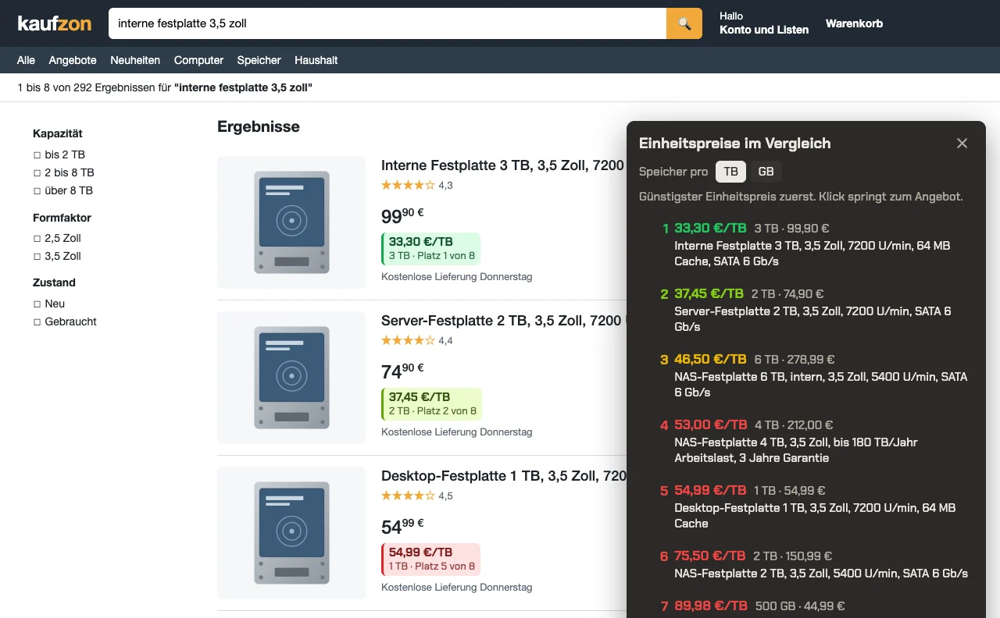

# Einheitspreis

Browser-Erweiterung für den Online-Shop: zeigt an jedem Angebot den Preis pro Einheit und sortiert die Angebote einer Seite danach. Welche Festplatte ist pro Terabyte am günstigsten, welches Waschmittel pro Waschladung? Die Antwort steht direkt unter dem Preis.



- **Speicher**: Preis pro TB oder GB (umschaltbar), auch für jede Größe auf der Produktseite
- **Waschmittel**: Preis pro Waschladung
- **Tabs, Kapseln, Pods**: Preis pro Stück
- **Lebensmittel und Flüssiges**: Preis pro Liter oder Kilogramm, bevorzugt der Grundpreis, den der Shop selbst angibt
- **Karussells und Empfehlungen**: jede Angebotskarte der Seite, etwa Werbeleisten, "Kunden ... haben auch angesehen", "Wird oft zusammen gekauft" oder "Weiter einkaufen"; derselbe Artikel zählt nur einmal
- **Vergleichsliste**: schwebender Knopf unten rechts, günstigster Einheitspreis zuerst, Klick springt zum Angebot

Jedes Abzeichen nennt die erkannte Menge (etwa "5 x 32 GB"), damit jede Zahl nachprüfbar ist. Farben: grün = günstigster, hellgrün bis 15 % teurer, gelb bis 40 %, rot darüber, blau = einziges Angebot dieser Einheit.



Die Bilder zeigen eine neutrale Vorführseite (`test/ansicht/`), auf der die echte Erweiterung läuft. Unterstützte Shop-Adressen stehen in `manifest.json`.

## Installieren

1. Dieses Repo herunterladen oder klonen
2. In einem Chromium-basierten Browser die Erweiterungsseite öffnen (Adresse `chrome://extensions` bzw. die Entsprechung des Browsers)
3. Oben rechts **Entwicklermodus** einschalten
4. **Entpackte Erweiterung laden** und den Ordner mit `manifest.json` wählen
5. Shopseite neu laden

Nach einer neuen Fassung auf der Erweiterungsseite das Neuladen-Symbol der Erweiterung drücken und die Shopseite neu laden.

## Erkennung

Der Rechenkern (`core/`) ist frei von Browser-Schnittstellen und liest die Menge aus Titel oder Variantenbezeichnung:

| Quelle | Vorrang |
|---|---|
| Speicher (TB/GB), Waschladungen, Tabs/Kapseln aus dem Text | 1 |
| Grundpreis des Shops ("12,60 €/l"), außer er lautet nur "€/Stück" | 2 |
| Liter, Kilogramm, Stück aus dem Text | 3 |

Berücksichtigt werden Faktoren ("6 x 1,5 l", "12x0,5l", "6 x 12 x 85g", "12x 600ml (338g)"), Packungen ("3er Pack", "28 Stück", "28 Premium Gaskartuschen", "... (28)", "2 Packungen mit 1 kg" ohne Doppelzählung), deutsche und englische Zahlen ("1.000 g", "1,5 l", "1.595 lt.", "256-GB-Karte"). Nennt der Shop nur einen Preis je Stück, ergibt sich daraus die Stückzahl; gilt sein Grundpreis erkennbar nur für ein Stück der Packung, zählt die eigene Rechnung. Gewicht geht vor Volumen ("CO2-Zylinder 425g/60l"). Verworfen werden Raten, Grenzwerte, Passformen und Arbeitsspeicher ("180 TB/Jahr", "7.400 MB/s", "bis zu 24 TB", "für 5- & 11kg-Flaschen", "8GB DDR4"); "256 MB Cache" verliert gegen die Kapazität.

Geprüft ist die Erkennung an 910 echten Suchtreffern aus Speicher, Lebensmitteln, Waschmittel, Batterien und Tierfutter (`test/fixtures`).

## Aufbau

| Ort | Aufgabe |
|---|---|
| `core/quantity.js` | Menge und Dimension aus Text |
| `core/money.js` | Geldbeträge lesen und schreiben |
| `core/unit-price.js` | Einheitspreis und Vorrang der Quellen |
| `core/ranking.js` | Rang und Farbstufe je Vergleichsgruppe |
| `content/amazon-dom.js` | einziger Ort, der den Seitenaufbau des Shops kennt |
| `content/badge.js`, `content/panel.js` | Abzeichen und Vergleichsliste |
| `content/main.js` | Ablauf, beobachtet nachgeladene Inhalte |
| `content/settings.js` | Einstellungen, ein Speicherschlüssel |

## Entwicklung

```bash
npm install
npm run vendor   # Schrift und Icons nach vendor/ übernehmen
npm test         # Rechenkern gegen echte Suchtreffer (test/fixtures)
npm run zip      # Paket nach store/
```

Vorführseite: den Ordner über einen lokalen Server ausliefern (etwa `python3 -m http.server`) und `test/ansicht/kaufzon-produkt.html` oder `test/ansicht/kaufzon-suche.html?liste=offen` öffnen.

Prüfstand mit echten Seiten: eine gespeicherte Shopseite als `test/live/live-<name>.html` ablegen, `node test/build-live.mjs` ausführen und `test/live/live-<name>.ep.html` über den lokalen Server öffnen.

## Datenschutz

Siehe [PRIVACY.md](PRIVACY.md): keine Daten verlassen den Browser.

## Lizenz

**Nicht-kommerzielle Nutzung** -- Siehe [LICENSE](LICENSE)

Erlaubt: Private Nutzung, Installation, persönliche Anpassungen, Teilen mit Quellenangabe

Verboten: Kommerzielle Nutzung, Verkauf, Einbindung in kommerzielle Produkte

---

## Unterstützen

Einheitspreis ist ein privates Hobby-Projekt. Kein Tracking, keine Werbung, keine Kompromisse.

Wenn dir das Projekt gefällt, kannst du ihm einen Stern geben -- oder direkt hier:

[](https://ko-fi.com/HalloWelt42)

**Crypto:**

| Coin | Adresse |
|------|---------|
| BTC | `bc1qnd599khdkv3v3npmj9ufxzf6h4fzanny2acwqr` |
| DOGE | `DL7tuiYCqm3xQjMDXChdxeQxqUGMACn1ZV` |
| ETH | `0x8A28fc47bFFFA03C8f685fa0836E2dBe1CA14F27` |

Copyright (c) 2026 HalloWelt42
